# ちびスタックちゃん 取扱説明書

おしゃべりロボット「ちびスタックちゃん」を受け取った方向けの説明書です。

**最初にやることは、おうちの Wi-Fi を教えてあげることだけ**です。
それ以外の面倒な設定は、ぜんぶ済ませてお渡ししています。

> 📱 **スマホで読むなら** → [はじめの設定ガイド（HTML版）](docs/setup-guide.html)
> セットアップ手順だけを、図を大きく載せて 1 ページにまとめたものです。
>
> 📖 この説明書で「**APIキー管理者**」と書いてあるのは、**この子をあなたに渡した人**の
> ことです。おしゃべりに使うAIサービスの契約と料金を管理しています。
> 困ったときの連絡先だと思ってください。
>
> 作る側・開発者向けの情報は [README.md](README.md) にあります。

---

## はじめに ── 全体の流れ（5ステップ・10分）

| | やること | かかる時間 |
|---|---|---|
| **STEP 1** | USBをつないで電源を入れる | 10秒 |
| **STEP 2** | 15秒待って「SETUP MODE」の画面が出るのを確認する | 20秒 |
| **STEP 3** | スマホの Wi-Fi を、ちびスタックちゃん本体につなぐ | 1分 |
| **STEP 4** | ブラウザで `192.168.4.1` を開く | 1分 |
| **STEP 5** | おうちの Wi-Fi 名とパスワードを入れて「保存してつなぐ」 | 2分 |

**用意するもの**

- スマホ（またはパソコン）
- USB充電器（スマホ用でOK）
- おうちの **Wi-Fi の名前（SSID）とパスワード**
  → ルーター本体に貼ってあるシールに書いてあります。先に手元に用意してください

> ⚠️ **いちばん大事な注意**
> ちびスタックちゃんは **2.4GHz の Wi-Fi にしかつながりません**。
> 5GHz（名前の最後が `-a` `-A` `5G` のもの）を入れると、何度やっても失敗します。
> 詳しくは [STEP 5](#step-5--おうちの-wi-fi-を入力する) を見てください。

---

## 準備 ── 本体のボタンは2つだけ

先にこれだけ覚えてください。**画面そのものが押しボタン**です。

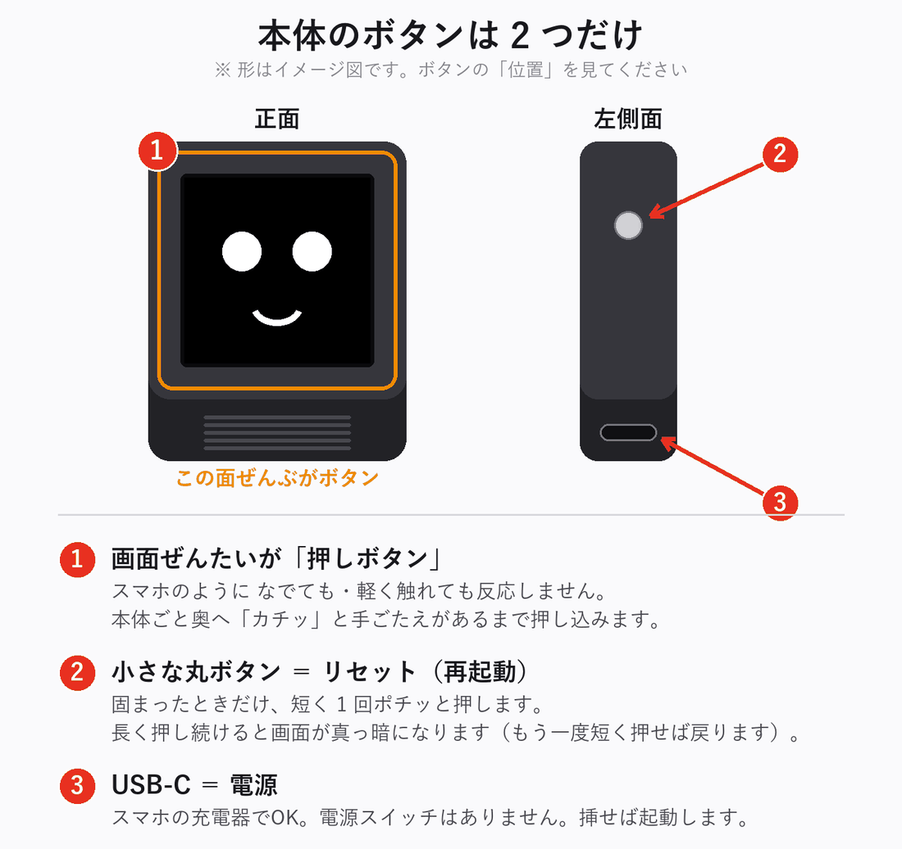

- **画面はスマホのようになでても・軽く触れても反応しません。**
  本体ごと奥へ「**カチッ**」と手ごたえがあるまで押し込みます
- 反応しないときは、たいてい**押し込みが浅い**のが原因です

---

## STEP 1 ── USBをつないで電源を入れる

付属の **USB-C ケーブル**をUSB充電器につなぐだけです。電源スイッチはありません。

10秒ほどで、こんな画面になります。

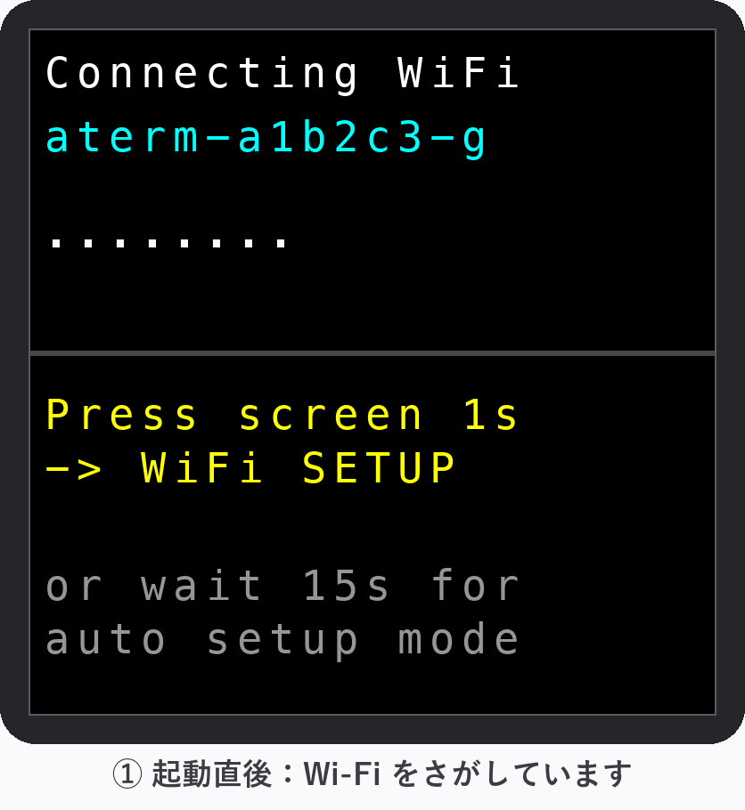

- `Connecting WiFi` ＝「Wi-Fiをさがしています」という意味です
- その下の青い文字は、**前の持ち主の家のWi-Fi名**です。あなたの家には無いので、
  当然見つかりません。**これで正常です**
- 点（`.`）がだんだん増えていきます

> 💡 **顔が表示されてしまった場合**は、すでにこの家のWi-Fiに接続できています。
> セットアップは不要です。[話しかけ方](#話しかけ方)へ進んでください。

---

## STEP 2 ── 「SETUP MODE」の画面が出るのを待つ

**15秒ほどそのまま待ちます。**
「**ピッ、ポーン**」と音が鳴って、オレンジ色の帯の画面に自動で切り替わります。

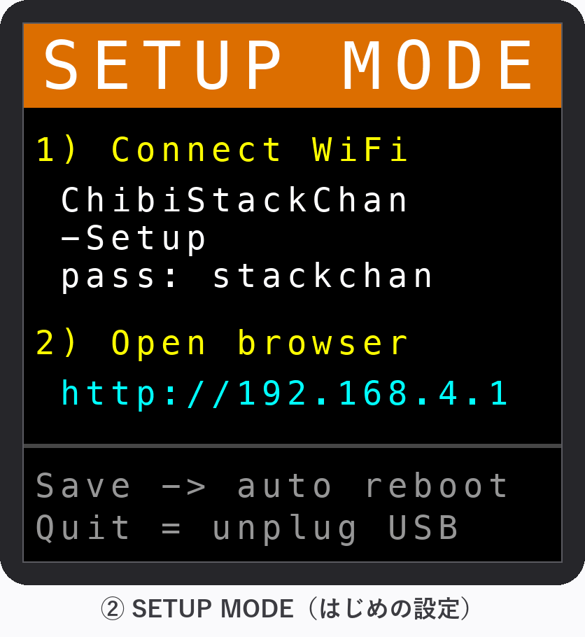

この画面が出たら準備OKです。画面には、次のステップで使う情報が書いてあります。

| 画面の表示 | 意味 |
|---|---|
| `1) Connect WiFi` `ChibiStackChan-Setup` `pass: stackchan` | STEP 3 でつなぐ Wi-Fi の名前とパスワード |
| `2) Open browser` `http://192.168.4.1` | STEP 4 で開くアドレス |

> 💡 **待たずにこの画面へ行きたいとき**は、点が出ている間に
> **画面をカチッと押したまま1秒**キープします。
> （すでに顔が出ているときは、**押したまま3秒**キープ）

**うまくいかないとき**

| 症状 | 対処 |
|---|---|
| 15秒たっても切り替わらない | もう10秒待ってください。それでも変わらなければ、USBを抜き差しして最初から |
| 画面が真っ暗 | 左側面のボタンを**短く1回**ポチッと押す、またはUSBを抜き差し |
| 顔が出てしまった | 画面を**押したまま3秒**キープすると SETUP MODE に入れます |

---

## STEP 3 ── スマホをちびスタックちゃんにつなぐ

ここが**いちばん間違えやすいところ**です。ゆっくり進めてください。

いまから、**スマホの接続先を一時的にちびスタックちゃん本体に切り替えます**。
（設定が終わったら、おうちの Wi-Fi に戻します）

### 3-1. スマホの「設定 › Wi-Fi」を開く

一覧に **`ChibiStackChan-Setup`** が出てくるので、これをタップします。

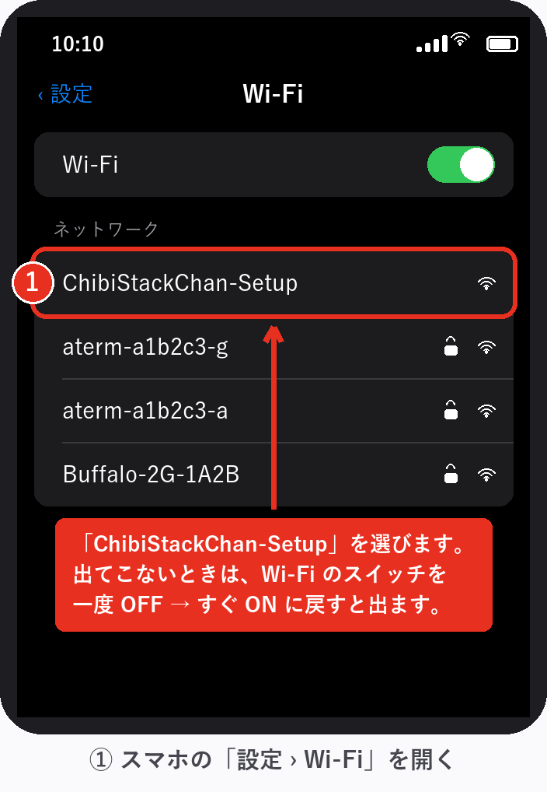

> 💡 **一覧に出てこないときは、Wi-Fi のスイッチを一度 OFF にして、すぐ ON に戻してください。**
> 一覧が読み込み直されて出てきます。よくあることなので、あわてなくて大丈夫です。

### 3-2. パスワードは `stackchan`

**すべて半角の小文字**で入力し、右上の「接続」を押します。

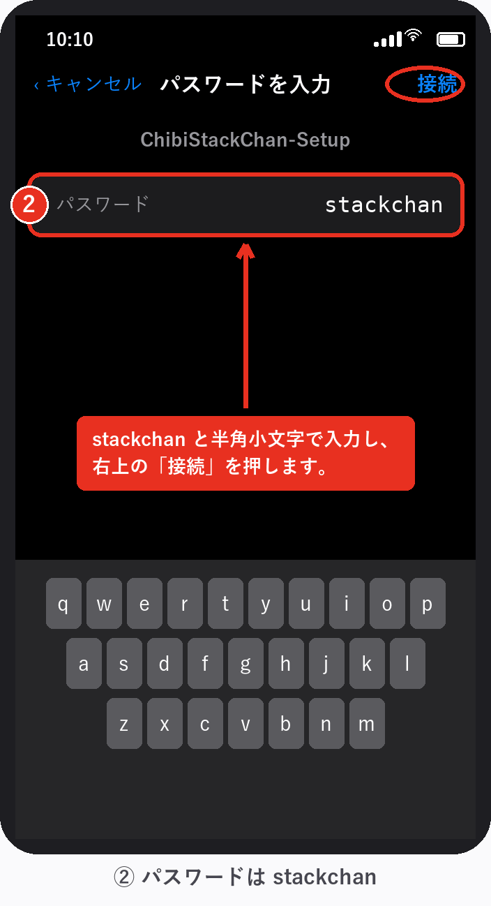

### 3-3. 「インターネット未接続」と出ても、そのまま進む

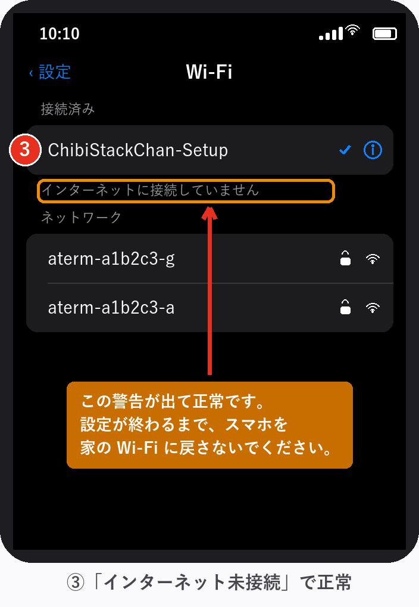

> ⚠️ ここで「インターネットに接続していません」「安全ではありません」などの警告が
> 出ますが、**それで正常です**。ちびスタックちゃん本体は、インターネットには
> つながっていない小さなWi-Fiだからです。
>
> **設定が終わるまで、スマホを元のWi-Fiに戻さないでください。**

**うまくいかないとき**

| 症状 | 対処 |
|---|---|
| `ChibiStackChan-Setup` が一覧に出てこない | **Wi-Fi のスイッチを一度OFFにして、すぐONに戻す**と出てきます。それでも出なければ、本体の画面がオレンジの「SETUP MODE」か確認（STEP 2） |
| パスワードが違うと言われる | `stackchan` を**半角小文字**で。日本語入力がオンだと全角になります |
| 接続してもすぐ元のWi-Fiに戻る | スマホの「自動接続」が働いています。もう一度手動で選び直してください |

---

## STEP 4 ── ブラウザで `192.168.4.1` を開く

スマホのブラウザ（Safari など）を開き、**アドレス欄**に半角で入力します。

```
192.168.4.1
```

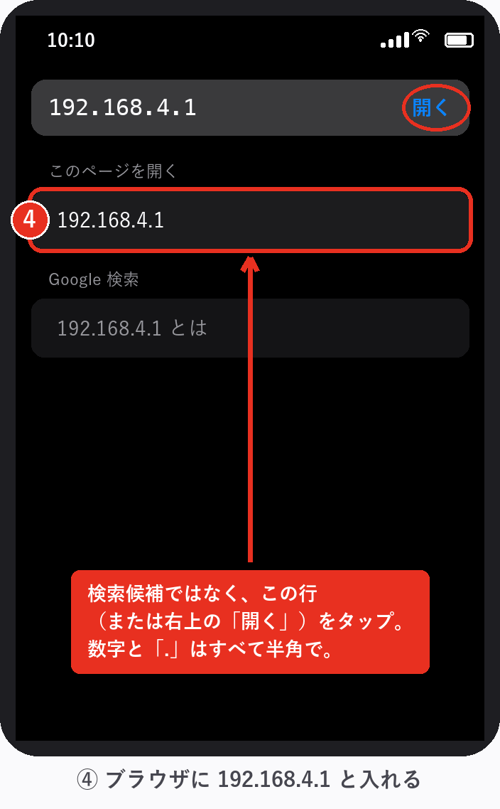

> ⚠️ **ここが最大のつまずきポイントです。**
> 入力すると、下に「検索候補」と「このページを開く」の2種類が出ます。
> **検索候補ではなく、`192.168.4.1` そのもの（または右上の「開く」）をタップ**してください。
> 検索を選ぶと Google の検索結果が出てしまい、設定画面にたどり着けません。

- 数字も「`.`（ピリオド）」も**すべて半角**です
- `http://` は付けても付けなくても構いません
- **アドレス欄が見つからないとき**は、画面を下に少しスクロールすると出てきます

**うまくいかないとき**

| 症状 | 対処 |
|---|---|
| 「サーバが見つかりません」と出る | STEP 3 に戻り、スマホが `ChibiStackChan-Setup` につながっているか確認 |
| Google の検索結果が出た | 検索候補をタップしています。もう一度入力して「開く」の方を選んでください |
| いつまでも読み込み中 | スマホの**モバイル通信（4G/5G）を一時的にオフ**にすると通りやすくなります |

---

## STEP 5 ── おうちの Wi-Fi を入力する

オレンジ色の帯の「**SETUP MODE / はじめの設定**」というページが開きます。
**入力するのは2つだけ**です。

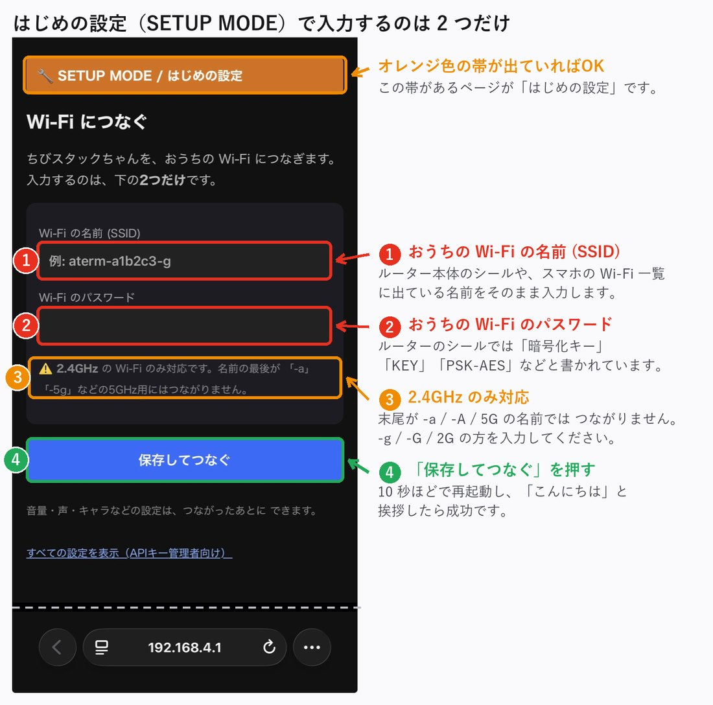

### ⚠️ 入れるのは「2.4GHz」の方です

Wi-Fi の一覧に、**末尾だけ違う似た名前が2つ**並んでいることがあります。
ちびスタックちゃんは **2.4GHz にしかつながりません**。

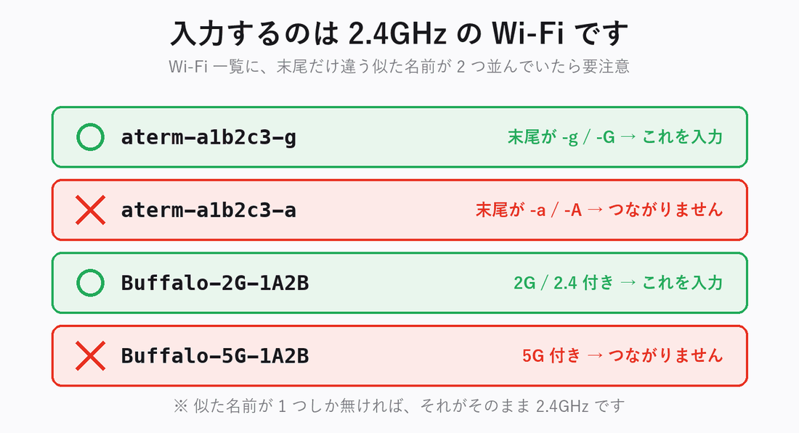

- 迷ったら、**スマホの Wi-Fi 一覧に出ている名前をそのまま**入力してください
  （STEP 3 で見た一覧です）
- ルーターのシールでは、パスワードは「**暗号化キー**」「**KEY**」「**PSK-AES**」
  などと書かれていることがあります
- **大文字・小文字・半角**を、シールのとおり正確に入力してください

入力したら、青い「**保存してつなぐ**」を押します。

---

## セットアップ完了の確認

「保存してつなぐ」を押すと、10秒ほどで自動的に再起動します。

**1.** 画面に **IPアドレス**（`192.168.x.x` のような数字）が数秒表示されます。
つながった証拠です。

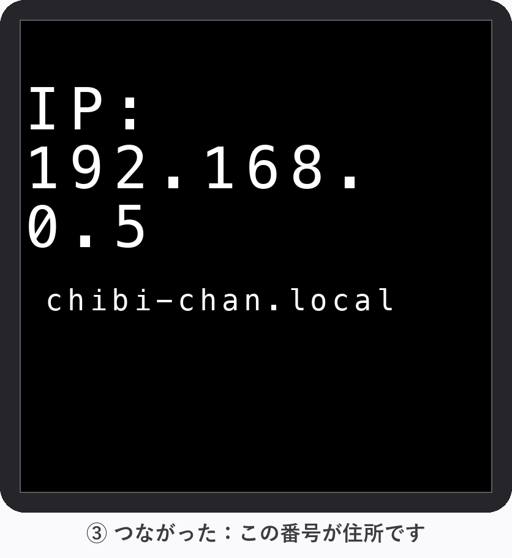

**2.** 続けて顔が出て、「**こんにちは、ちびスタックちゃんだよ**」と挨拶したら**完了**です🎉

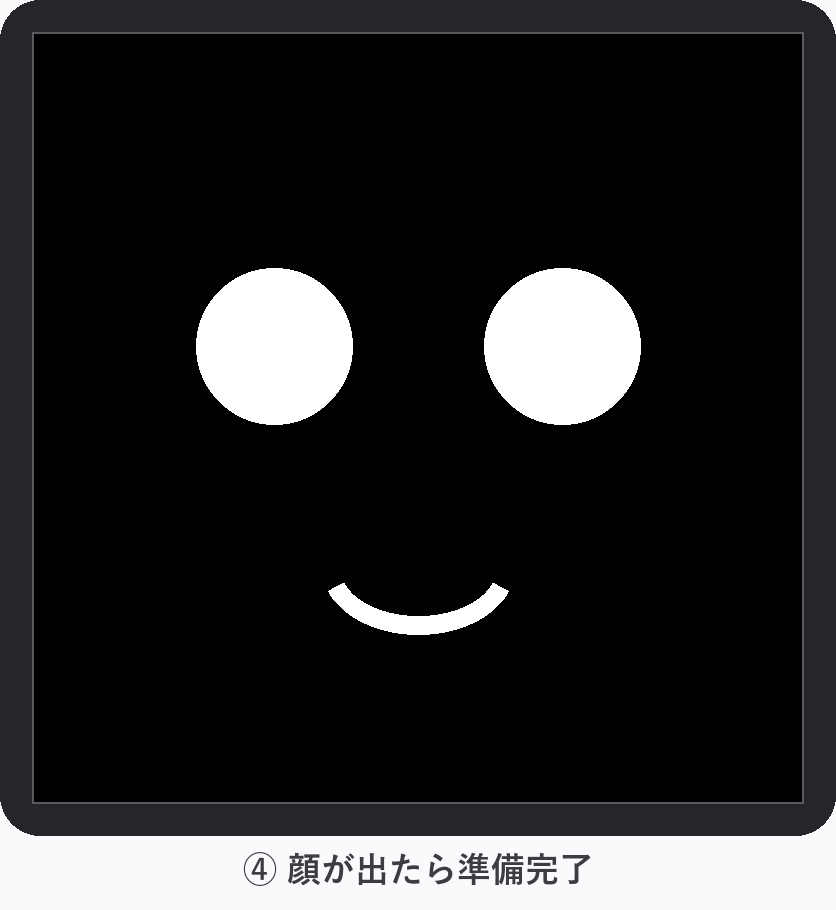

**3.** スマホの Wi-Fi を、**おうちの Wi-Fi に戻してください**。

> 💡 表示された IPアドレスは覚えなくて大丈夫です。あとで「**アイピー教えて**」と
> 話しかければ読み上げてくれます。

**完了しないとき**

| 症状 | 原因と対処 |
|---|---|
| また「SETUP MODE」に戻ってしまう | Wi-Fi 名かパスワードが違います。**5GHz を入れていないか**を最初に確認（STEP 5） |
| `WiFi NG` と表示される | 同上。STEP 3 からやり直してください |
| 顔は出るが無言 | Wi-Fi はつながっています。数分待っても喋らなければ APIキー管理者へ連絡 |

---

## 話しかけ方

**ふつうに話しかけるだけ**です。設定によって2つのモードがあります。

| モード | 話しかけ方 |
|---|---|
| なんでも返事 | 何を言っても返事します |
| 呼びかけワード | 「**スタックちゃん**、今日の天気は？」のように名前を呼んでから話す |

- 画面（顔）を**カチッと1回押す**と、呼びかけなしで聞いてくれます（ピッと鳴ったら話す）
- 30〜60cmくらいの距離で、ふつうの声の大きさでどうぞ

### 画面の色 ＝ いまの状態

| 顔の背景色 | 意味 |
|---|---|
| ⚫ 黒 | 待機中（話しかけてOK） |
| 🟢 緑 | 聞いています（録音中） |
| 🔵 紺 | 考え中（ちょっと待ってね） |

---

## できること

- 💬 **おしゃべり** — 質問、雑談、なんでも
- ☀️ **天気** — 「今日の天気は？」「傘いる？」
- 🕐 **時刻・日付** — 「いま何時？」
- ⏲️ **タイマー** — 「3分タイマーかけて」→ 時間が来たら教えてくれます。
  「タイマーやめて」「あと何分？」もOK
- 😴 **おやすみ** — 3分間話しかけないと居眠りします。声をかけると
  「寝てしまった！」と飛び起きます
- 🔊 **物音への反応** — 電子レンジの「チーン」など、聞き分けられた音には
  たまに反応して喋ります。ご愛嬌です

---

## 設定画面を開く（音量・声・キャラを変える）

セットアップが終わったあとは、**おうちの Wi-Fi 経由で**設定画面を開けます。

スマホやPCを**ちびスタックちゃんと同じWi-Fi**（ふつうは家のWi-Fi）につないで、
ブラウザのアドレス欄に以下のどちらかを入力します:

- `http://chibi-chan.local/`
- `http://（起動時に表示されたIPアドレス）/` — 忘れたら「**アイピー教えて**」と
  話しかけると読み上げてくれます

> 💡 `.local` の方はスマホの機種によって開けないことがあります。
> その場合はIPアドレスの方を使ってください（こちらは確実です）。
>
> 💡 **IPアドレスは、まれに変わることがあります**（ルーターの再起動や停電のあと、
> 長期間電源を切っていたあと、など）。開けなくなったら「**アイピー教えて**」で
> 今の番号を聞き直してください。ずっと同じ番号にしたい場合は、ご自宅のルーターで
> 「DHCP予約（IP固定）」を設定すると確実です（詳しい方に頼んでください）。

すると、こんなメニューが表示されます。

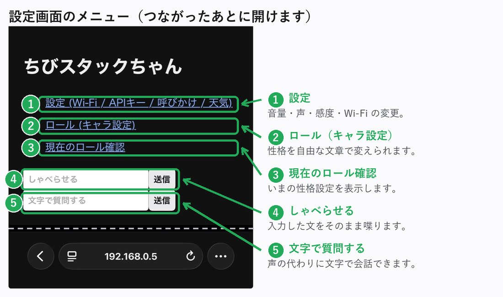

### 📌 おすすめ: ホーム画面に追加しておく

毎回アドレスを打たなくて済むように、**最初に1回だけ**この登録をしておくと、
以後はアプリのように**ホーム画面の1タップ**で開けます（iPhoneの例）:

1. Safariで上のメニュー画面を開く
2. 画面下のボタンからメニューを開き、「**共有**」をタップ（下の赤丸）

   

3. 出てきた一覧を少し下にたどって「**ホーム画面に追加**」をタップ（下の赤丸）

   

4. 右上の「追加」を押す → ホーム画面に「ちびスタックちゃん」のアイコンができます

---

## 音量・声・感度を変える

メニューの「**設定**」を開きます。**緑の枠がさわってよい所、赤の枠は絶対にさわらない所**です。

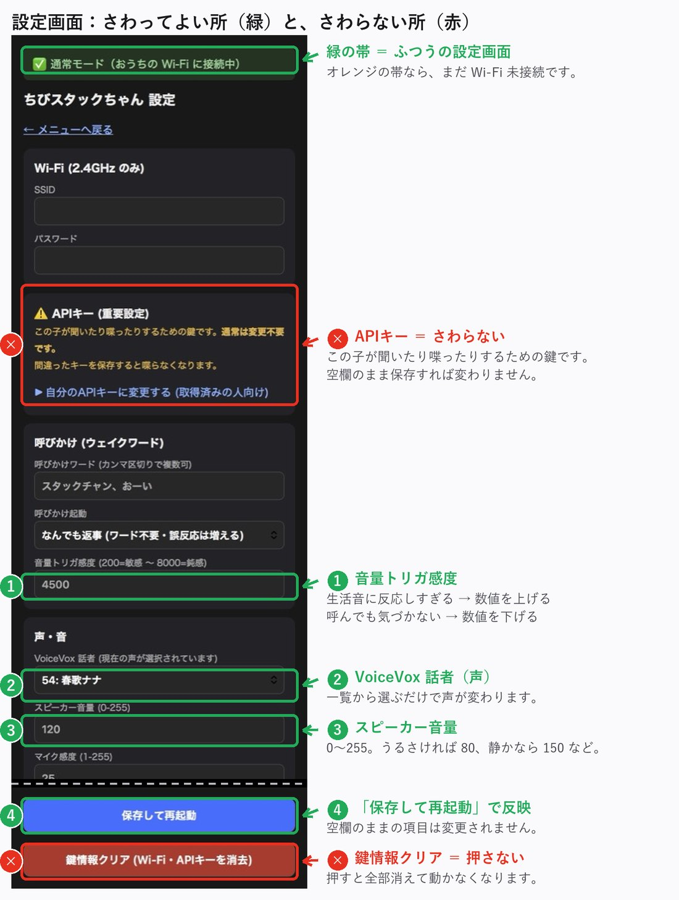

よく使うのはこの3つです（**空欄のままの項目は変更されません**）:

| 項目 | 説明 |
|---|---|
| スピーカー音量 | 0〜255。うるさければ80、静かなら150など |
| VoiceVox 話者 | 声のキャラクターを一覧から選ぶだけ |
| 音量トリガ感度 | 生活音に反応しすぎるなら数値を**上げる**、呼んでも気づかないなら**下げる** |

変えたら一番下の青い「**保存して再起動**」を押します。10秒ほどで再起動して反映されます。

> このほか「呼びかけワード」「天気の場所（地名・緯度・経度）」も同じ画面で変えられます。

---

## キャラ（性格）を変える

メニューの「**ロール（キャラ設定）**」で、性格を自由な文章で決められます。
枠に文章を入力して「送信」するだけです（**空欄で送信すると元の性格に戻ります**）。

書き方の例（そのまま貼ってもOK）:

```
あなたはコッテコテの大阪人です。ボケとツッコミを忘れずに使って下さい。
```
```
あなたは物知りでやさしいおばあちゃんです。ゆっくり丁寧に話します。
```


いまの設定は「**現在のロール確認**」で見られます。
**色付きの部分は本体が自動で追記する決まりごと**なので、自分で書く必要はありません。


---

## ⚠️ さわらないでほしいところ

設定画面の **「APIキー（重要設定）」** と赤いボタンの **「鍵情報クリア」** は、
この子が聞いたり喋ったりするための**心臓部**です。

APIキーは、この子を渡した人（＝**APIキー管理者**）のものが設定済みです。
料金もその人のアカウントに請求されるため、勝手に変えると動かなくなります。

- APIキーは**変更しないでください**
  （まちがえて開いても、キー欄に何も入力せず保存しなければ大丈夫です）
- 赤い「鍵情報クリア」を押すと**すべて消えて動かなくなります**
- 触ってしまって喋らなくなったら、**APIキー管理者に連絡**してください

（将来ご自分のAPIキーに切り替えたい場合は、APIキー管理者に相談するか
[README.md](README.md) の手順でキーを取得して設定できます）

---

## 困ったときは

### 引っ越した・ルーターを買い替えた

**[STEP 1](#step-1--usbをつないで電源を入れる) からもう一度**やり直してください。
すでに顔が出ている場合は、**画面を押したまま3秒**キープすると SETUP MODE に入れます。

### 症状別の対処

| 症状 | 対処 |
|---|---|
| 反応しない・画面が暗い | USBを抜き差しするか、左側面のボタンを短くポチッと押して再起動（データは消えません） |
| 画面を押しても反応がない | 押し込みが浅いかも。「カチッ」と手応えがあるまで押してください |
| 画面が「SETUP MODE」から進まない | Wi-Fiの登録がまだ、または Wi-Fi 名/パスワードが違います → STEP 3〜5 |
| 起動しても挨拶しない・無言 | Wi-Fiが切れている可能性。STEP 1 からやり直すか、再起動 |
| 緑にならない（聞いてくれない） | もう少し近くで・はっきり話す。設定の「音量トリガ感度」の数値を下げる |
| 「ごめん、うまく聞き取れなかったよ」と言う | 通信の一時的な不調です。少し待ってもう一度 |
| 「ただいま混み合っています」と言う | AIサービス側の混雑。数分待つ |
| 何を言っても無言 | Wi-Fiが切れたか、APIの問題。再起動して直らなければAPIキー管理者へ連絡 |
| 設定画面が開けない | 同じWi-Fiにいるか確認。「アイピー教えて」でアドレスを確認 |
| ホーム画面のアイコンで開けなくなった | 本体のアドレスが変わった可能性。「アイピー教えて」で今のアドレスを確認し、開き直してもう一度「ホーム画面に追加」 |
| テレビや生活音に反応しすぎる | 設定の「音量トリガ感度」の数値を上げる。または呼びかけモードを「呼びかけワードで起動」に |
| 画面が真っ暗になった | 側面のリセットボタンを**長く押しすぎ**た可能性。**もう一度短くポチッと**押すか、USBを抜き差し（壊れていません） |

**再起動はUSBの抜き差しでいつでもOK**。設定やキャラは本体に保存されているので消えません。

---

## かかるお金について

この子は喋るたびにインターネットのAIサービスを少しずつ使います。
料金は**この子を渡した人（APIキー管理者）のアカウント**に請求されます。
**1回の会話で1円未満、ふつうに使えば月に数百円程度**です。
常識の範囲で好きなだけ話しかけて大丈夫ですが、ラジオ代わりに一日中
話し続けるような使い方はAPIキー管理者と相談してください。
