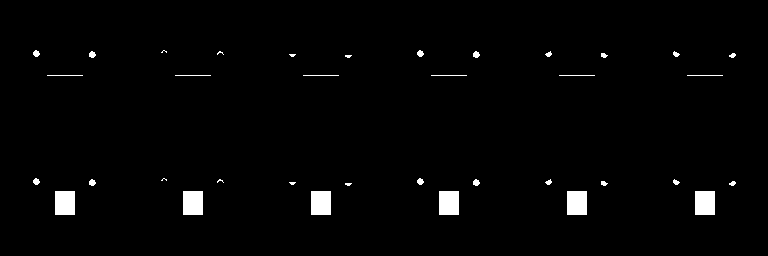

# ちびスタックちゃん Rustファームウェア

ATOMS3R＋Atomic Echo Base 向けに、アプリケーション全体を Rust で再構成した Cargo プロジェクトです。
Arduino・M5Unified の C++ ランタイムを使わず、`esp-idf-svc` / `esp-idf-hal` を通じて ESP-IDF の C SDK を呼び出します。
ESP-IDF の OS・Wi-Fi・TLS などは C SDK を利用し、設定・会話・音声処理・周辺機器の制御を Rust にまとめています。

現行のローカルクレートは、この `rust/firmware` と、顔描画の依存先 `rust/avatar-face` です。
ビルドとテストには Cargo と `scripts/firmware.py` を使います。

元の C++ 版と C++＋Rust 混在版は、整理前の
[固定チェックポイント `ffb5c747`](https://github.com/atatakeisi/chibi-stackchan-rust/tree/ffb5c74706a106e09211d558a028f2fccbaac537)
に保存しています。旧ルート `src/`・PlatformIO 設定・`rust/audio-core/` は、ユーザーの承認後に現行構成から削除しました。
旧版の `pio run` や `audio-core` のコマンドはチェックポイントの履歴用で、このアプリケーションの実行手順には使いません。
移行した機能と元ファイルの対応は [Rust への移行記録](../../docs/RUST_MIGRATION.md) を参照してください。

## 顔の自動回転（2026-10-18）

内蔵BMI270の加速度を100 ms間隔で読み取り、顔を0°・90°・180°・270°へ自動回転します。
向きが300 ms継続したときに切り替え、斜めの境界・大きな揺れ・画面の水平配置では直前の向きを保ちます。
ATOMS3R固有の取り付け補正 `[raw_y, -raw_x, raw_z]` は
[M5Unified 0.2.13の公式実装](https://github.com/m5stack/M5Unified/blob/0.2.13/src/utility/IMU_Class.cpp#L89-L93)に合わせています。
ジャイロ・地磁気は使用しません。センサー設定データの出典とライセンスは `src/bmi270-config.LICENSE` に記載しています。

発話中も回転判定を続け、向きの切り替え時にもLCD転送を重複させません。
LCDの初期化・アドレス設定は維持し、追加の32 KiBバッファでRGB565画像を回転します。
センサーの初期化失敗時は固定表示で本体の動作を継続します。
読み取りが3回連続で失敗した場合は1秒間隔で復帰を試し、成功すると100 ms間隔へ戻ります。
読み取り専用 `/status` の `orientation` で、生加速度（mg）・回転番号（0～3）・サンプル数・有効状態・
起動からの経過時間・リセット理由を確認できます。USBを再接続せずに動作を調べられます。

ホストテスト104件とESP32-S3向けreleaseビルドが成功しました。
実機のフラッシュ全体を非公開の `.tools/backups/atoms3r-before-auto-rotation-20261018.bin` へ保存し、
パーティションテーブル・OTA選択を照合したうえでapp0だけを書き込み、ハッシュ検証・起動・マイク復帰を確認しました。
既存のWi-Fi・APIキー・音量などの設定は保持しています。イメージは1,908,912バイトです。
SHA-256: `768db9ffebe25cf4b57509553d9f742f504dc75ba2af601c6ad776c80f557b6a`。

USBを開き直さず約2分間Webで監視し、姿勢変更中の四方向への切り替え、uptimeの継続、センサー読み取りの継続を確認しました。
確認用音声は146,304フレームの再生完了を `/status` で確認し、Web画面への直接接続もHTTP 200でした。
以前の監視中に記録された再起動理由は `USB_UART_CHIP_RESET` でした。
修正版の実機をユーザーが確認し、自動回転を良好と評価したうえで、**再起動が起きないこと、タイマー、天気、音量調節**の動作を確認しています。

## ビルドとテスト

Python 3、ホスト用の Cargo、および Espressif の Xtensa Rust ツールチェーン `esp` が必要です。
この作業環境では `esp` を導入済みです。別の環境では ESP32-S3 と Rust 標準ライブラリのビルドに対応するツールチェーンを用意してください。

次のコマンドは、リポジトリのルートから実行します。

```sh
# 初回の Rust 依存取得
cargo fetch --manifest-path rust/firmware/Cargo.toml

# リンカー用ツールをプロジェクト内 .tools/ にインストール
python3 scripts/firmware.py tools

# 顔描画ライブラリとファームウェアをホストで検証（依存取得後はオフライン実行）
python3 scripts/firmware.py test

# ESP32-S3 向け release ビルド
python3 scripts/firmware.py build

# リンク前のターゲット型チェック
python3 scripts/firmware.py check
```

ヘルパーは `rustup run esp cargo` を呼び出し、`ldproxy` の場所を Cargo の設定引数で渡します。
`source export-esp.sh`、環境変数の書き換え、既定の Rust ツールチェーンの切り替えは不要です。
`ldproxy` を既に利用できる環境では `tools` を省略できます。

初回のターゲットビルドでは ESP-IDF・C ツール・mDNS コンポーネントの取得にもネットワークを使います。
生成物はプロジェクト内の `target/`、`.embuild/`、リポジトリ内の `.tools/` に置かれます。
ヘルパーはマシン固有のパーティション CSV 絶対パスを `sdkconfig.partition.defaults` に生成します。

使用する主なバージョンは次のとおりです。

| 項目 | バージョン・設定 |
|---|---|
| Rust ターゲット | `xtensa-esp32s3-espidf` |
| ESP-IDF | `v5.4.2` |
| `esp-idf-svc` | `0.53.0` |
| mDNS コンポーネント | `espressif/mdns`、ロック済み `1.2.5` |
| フラッシュ / PSRAM | 8 MiB / 8 MiB、Octal PSRAM |

依存は `Cargo.lock` と `components_esp32s3.lock` に記録しています。
ターゲットの ELF とアプリケーション用バイナリは次の場所に生成されます。

```text
rust/firmware/target/xtensa-esp32s3-espidf/release/stackchan-firmware
rust/firmware/target/xtensa-esp32s3-espidf/release/stackchan-firmware.bin
```

`build` はビルド後に ESP-IDF 付属の esptool でアプリケーション用 `.bin` を生成し、
app0 の容量 `0x330000` 以下であることと SHA-256 を表示します。
既存の ELF から変換だけ行う場合は `python3 scripts/firmware.py image` を使います。

## 実装した機能

| 分野 | Rust 版の内容 |
|---|---|
| 音声入力 | Atomic Echo Base の ES8311 / PI4IOE 制御、I2S、16 kHz・16 bit モノラル録音 |
| 録音判定 | 起動・再生後のウォームアップ、音量 VAD、直前 1 秒のプリロール、無音 2 秒で終了、最大 12 秒、WAV 化 |
| 音声認識 | OpenAI Whisper、無音時の幻聴抑制、複数の呼びかけワード、呼びかけ不要モード |
| 会話 | Gemini / Claude の切り替え、履歴管理、変更可能なキャラ設定、感情・タイマータグ |
| 音声出力 | VOICEVOX、MP3 デコード、16 kHz へのリサンプリング、I2S 再生、再生中の音量・ミュート反映、口パク、音声命令による音量変更・保存・ミュート解除 |
| 時刻・天気 | SNTP、UTC＋9 の日本時間、Open-Meteo、IP アドレスの読み上げ |
| タイマー・睡眠 | 定型タイマー操作、ローカル警告音、3 分無操作で睡眠、起床・通信断の音声キャッシュ |
| 画面 | ATOMS3R の GC9107 / ST7735S を判定、元の Avatar の形・配置による 128×128 の顔・状態・設定情報表示 |
| サーボ | Grove G2 の SG90 用 50 Hz PWM、待機・会話・睡眠時の動作 |
| ネットワーク | Wi-Fi、接続失敗時の設定 AP、キャプティブ DNS、mDNS、切断時の再接続 |
| 設定 | Web UI、入力検証、NVS 保存、Arduino 設定の移行、旧 SPIFFS ロール・音声の読み込み |

## モジュール構成

| ファイル | 役割 |
|---|---|
| `src/main.rs` | ESP-IDF 初期化、アプリケーション開始 |
| `src/diagnostics.rs` | 実機のヒープ・スタック・メモリ割り当て診断 |
| `src/device.rs` | 録音・会話・再生の状態管理、ボタン、睡眠、設定コマンドの実行 |
| `src/board.rs` | コーデック、I2S、ボタン、サーボ、MP3 再生 |
| `src/display.rs` | LCD の識別・初期化・転送、背景状態色と設定情報の表示、顔描画ライブラリの呼び出し |
| `../avatar-face/src/lib.rs` | LCD から独立した元の Avatar の顔形状・縮小・回転・RGB565 描画 |
| `../avatar-face/src/animation.rs` | まばたき・視線・呼吸・視線に連動した傾きから描画パラメーターを生成 |
| `src/audio.rs` | VAD、録音バッファ、解析、WAV ヘッダー |
| `src/playback.rs` | ストリーム音声のダウンミックス、共有音量制御、リサンプリング、再生済み PCM の診断値 |
| `src/voice_volume.rs` | 音量の音声命令の解析、増減・指定値・ミュート・復元・現在値の解決 |
| `src/voice_action.rs` | AI の音量操作タグと現在の依頼の照合、数値の検証、発声前のタグ除去 |
| `src/conversation.rs` | 呼びかけ判定、会話履歴、ロール、表情、タイマー |
| `src/services.rs` | Whisper / Gemini / Claude / VOICEVOX / 天気、HTTPS 通信 |
| `src/network.rs` | Wi-Fi、設定 AP、DNS、mDNS、SNTP、日本時間 |
| `src/config.rs` | 設定値、既定値、範囲検証 |
| `src/storage.rs` | Rust 設定保存、旧 NVS / SPIFFS 読み込み |
| `src/web.rs` | HTML、フォーム解析、HTTP ルート、操作キュー |

音声と保存処理はデバイスタスクが順に実行します。
Web サーバーは入力を検証して上限付きキューに渡し、受け付けたことを返します。
保存成功後に表示用の設定が更新され、処理結果はメニューに表示されます。
音声による音量変更も同じ保存設定に反映します。Web 操作との競合時は変更順序を照合し、
古い保存待ちの命令で新しい音量を上書きしないようにしています。
設定処理の排他制御中も、PCM 再生側は原子的な音量値を読み、ロックを待ちません。

顔描画は [stackchan-avatar-face](../avatar-face/README.md) に分離しています。
M5Stack-Avatar 0.10.0 の `Face.cpp`・`Eye.cpp`・`Mouth.cpp` を基に、元の C++ 設定と同じ
縮尺 `0.4`、位置 `setPosition(-56, -96)` で白い小さな丸目と四角い口を描きます。
追加した水色の目・ハイライト・ピンクの頬・通常画面の状態ラベルは除去しました。
録音中の緑・思考中の紺などの背景色と設定画面は引き続き LCD 側が担当します。
音声の口パクは音量調整前の PCM 振幅を使い、小音量でも口が動きます。
顔描画ライブラリに ESP-IDF の依存はなく、フレームごとのヒープ確保もありません。
顔のない領域は背景として塗り、目・口の周辺だけを逆変換して描画負荷を減らしています。
LCD の SPI 転送はポーリングを避け、音声の PCM 供給を妨げにくい設定にしています。
再生ログの `Playback timing` は音声長と処理時間、PCM 供給間隔の最大値、
顔描画と LCD 転送の最大時間を記録します。



左から Neutral / Happy / Sleepy / Doubt / Sad / Angry、上段は口を閉じ、下段は口を開いた状態です。
形状と配置を元の実装に合わせていますが、回転は浮動小数点による変換のため、
LovyanGFX の固定小数点処理と境界の画素が異なる場合があります。
視線移動では元の右目にあった縦横値の取り違えを修正しており、動きまで画素単位で同一とはしていません。
ユーザーが実機の画面を確認し、「元の顔に戻った」と回答しました。

## 設定とデータの引き継ぎ

初回は既存 Arduino の NVS 名前空間 `wifi` / `chibi` / `setting` から設定を読み込みます。
Rust 版で保存すると `rustchan` 名前空間に設定一式を JSON blob として記録し、次回からこちらを優先します。
ロールは Rust の NVS 保存値を優先し、未保存なら SPIFFS の `/data.json` から既存ロールを読み込みます。
`include/secrets.h` は Rust 版の初期値には使いません。

NVS は `EspDefaultNvsPartition::take_with(false)` で開きます。
空きページ不足や未対応形式で初期化できない場合も自動消去せず、既存データを保持して起動エラーを返します。
SPIFFS のマウント失敗時に自動フォーマットを実行しません。
既存の `wake.mp3` / `nonet.mp3` を読み込み、キャッシュ生成では既存ファイルを保持します。
「Wi-Fi・APIキーを消去する」操作は、確認後にそれらを空にした Rust 設定を保存し、
旧 Arduino の `wifi` / `chibi` にある SSID・パスワード・APIキーも空にします。
`nofallback=1` を保存するため、Arduino 版へ戻しても初期キーの自動復元を抑止します。
初回移行時の読み込みでは既存値を書き換えません。

Wi-Fi 接続は初回約 15 秒で打ち切り、設定 AP へ移行します。
通常時の切断では約 15 秒ごとに再接続を要求し、2 分間復旧しなければ設定 AP に移行します。
起動時の画面ボタン押下、通常時の画面ボタン 3 秒長押しでも設定 AP を開きます。

| 接続・URL | 内容 |
|---|---|
| `ChibiStackChan-Setup` / パスワード `stackchan` | 設定 AP、2.4 GHz |
| `http://192.168.4.1/` | 設定 AP の Web UI |
| `http://chibi-chan.local/` | 通常 Wi-Fi 上の Web UI。名前解決できない場合は画面の IP を使用 |
| `/config`（`/wifi` も対応） | Wi-Fi、APIキー、声、呼びかけ、天気 |
| `/role`（`/role_get` も対応） | 現在のロール表示と編集 |
| `/status` | 保存音量・実際の再生音量・直近 MP3 再生の数値診断を返す読取専用 JSON |

保存済みのパスワードや APIキーは HTML に埋め込みません。
設定の空欄は現在値を保持し、パスワードなし Wi-Fi は専用チェック欄で指定します。
変更操作はメニューの POST フォームを使います。旧版の `/speech?say=...` などの GET 操作は 405 を返します。
会話・認識・音声合成は、起動後に利用すると設定した外部サービスへ通信します。

`/status` の `saved_volume` は保存済みの音量、`live_volume` は PCM 出力に適用する現在値、
`last_nonzero_volume` はミュート解除時の復元値です。
`last_playback` は最後まで完了した MP3 再生について、音量適用前後のピーク
（`source_peak` / `output_peak`）、適用音量の最小・最大値（`volume_min` / `volume_max`）、
フレーム数（`frames`）、元 PCM の識別値（`source_fingerprint`）を返します。
識別値は音量適用前の PCM の FNV-1a で、同じ音声の出力を比較するための診断値です。
診断値の取得は増幅率を変えず、JSON に認証情報・文字起こし・発話本文は含めません。

音量命令の取り違えを調べる診断は、USB のローカルログで音量関連の文字起こし・
呼びかけ処理後の命令・処理経路を最大 256 文字に制限して記録します。
音声データや NVS には保存せず、Web に文字起こしを返す診断エンドポイントは設けません。
Web の `/status` は引き続き数値だけを返します。

## 音声で音量を変える

通常の会話と同じ手順で話しかけます。呼びかけワード方式では、
「スタックちゃん、音量を下げて」のように登録したワードを付けます。
なんでも返事モードではワードは不要です。呼びかけ起動が無効なら画面をクリックしてから話してください。
Whisper で文字起こしした後、定型の音量命令は会話 AI に送る前に本体で処理します。
音声認識にはネットワークと OpenAI の API キーが必要です。
画面クリック後・聞き返しへの応答・Web の文字入力にも登録した呼びかけが含まれる場合は、
音量命令を判定する前にその先頭部分を取り除きます。
「おーい」「ねえ」などの前置きや丁寧な語尾も扱います。
「音量、20にして」のような音量名の直後の読点や、「おんりょう」などの仮名表記も扱います。
登録した呼びかけについても文字起こしの仮名表記を照合します。
実機で「おーい、音量20にして」が「大い・音量二重にして」と認識されたため、
この前置きと、音量の数値部分の「二重」を 20 として扱う補正を追加しました。
この補正を一般会話や「二重人格」などの言葉には適用しません。
これによって呼びかけ条件を無効にすることはなく、自動録音時は設定した呼びかけ方式に従います。

定型解析で扱えず会話 AI に渡った場合は、AI が返した音量操作タグを検証し、
本体の同じ保存・音量制御処理で適用してから確認応答を作ります。
タグは現在のユーザーの操作依頼と照合し、引用・否定・範囲外の値などは変更に使いません。
AI の返答文だけで変更したことにはせず、操作タグが無効なら変更せずに案内します。

| 言い方の例 | 動作 |
|---|---|
| 「音量を下げて」「スタックちゃん音量下げて」「声を小さくして」「もう少し小さくして」 | 0〜255 の値を 2 下げる |
| 「音量を上げて」「声を大きくして」「もう少し大きくして」 | 0〜255 の値を 2 上げる |
| 「音量を10にして」 | Web と同じ 0〜255 の値で 10 にする |
| 「音量を10パーセントにして」 | 明示した割合を 0〜255 に換算し、26 にする |
| 「ミュートして」「おーい、ミュートして」「音を消して」 | 音量を 0 にしてスピーカーを消音する |
| 「ミュート解除」「音量を戻して」 | 最後に保存した 0 以外の音量へ戻す |
| 「今の音量を教えて」 | 現在の 0〜255 の値を知らせる |

変更値と最後の 0 以外の音量は NVS に保存し、再起動後も引き継ぎます。
Web から変更した音量もミュート解除時の復元値に反映します。
既存設定に復元値がない場合の既定値は 10 です。現在値は勝手に変更しません。
ミュート中もマイクは動作するため、音声で解除できます。
消音中は応答内容を Web メニューに表示し、無音の確認応答のための音声合成通信は行いません。
0 以外への変更では、新しい音量で音声による確認応答を行います。
範囲外の値など、音量設定として受け付けられない命令は説明を表示し、音量を変更しません。
前の版では文字入力で変更・保存を確認しましたが、その後のユーザーテストではミュート・解除が動いた一方、
「おーい音量20にして」「スタックちゃん音量上げて」が通常の AI 会話へ流れ、反映されませんでした。
このため読点・仮名表記の解析と AI 操作タグの取り扱いを追加修正しています。
追加修正後、上げる・下げる命令は実際の声で変更と返答を確認しました。
ユーザーは補正後の実機で、ミュート・解除と数値指定 **30・20・5** を確認しました。
音量 **5 / 255** はとても小さい音で、許容できる音量であることも確認済みです。

## 書き込みと確認状況

最終確認日：**2026-10-17**。デスクトップの `chibi-stackchan-rust-main` が現在の作業元プロジェクトです。
今回の Rust コード・ビルド設定・修正はこのフォルダーへ直接保存しています。

**現行のホストテストは顔描画ライブラリ 12 件と Rust ファームウェア 86 件が成功し、ESP32-S3 向け release ビルドも成功**しました。
ホストテストは顔の形状・表情・バッファ境界とアニメーション、音声処理の境界、呼びかけ・タイマー、
API リクエストと応答のモック、フォーム・DNS の不正入力などを検証します。
音量の音声命令については、日本語・数値・割合・拒否する文、復元値の保存、Web 操作との競合時の順序も検証します。
顔描画の最適化は 512 通りの表情・回転などを全画面サンプリングと比較し、出力画素の一致を検証しています。
`python3 scripts/firmware.py test` は顔描画ライブラリとファームウェアを実行します。
以前の `audio-core` の 2 件は混在版の検証履歴で、現行のテスト対象には含めません。
そのソースと再現用コマンドは、整理前の固定チェックポイントと [旧混在版の記録](../../RUST_INTEGRATION.md) に残しています。

最新の実機テストでは、ユーザーが次の操作・聞こえ方を確認しました。

- 音声によるミュート・解除と、音量 **30・20・5** の数値指定。音量 5 はとても小さく、許容範囲。
- 「スタックちゃんタイマー1分」による設定と、1 分後の音声通知。
- 通常の問いかけへの会話応答と、設定地点の天気の応答。
- iPhone の Web 画面からの設定変更・本体操作。
- 元の顔への復元と、描画負荷修正後の自然な音声。

サーボの実動作は未確認です。以下の音量 10・15・17 などの値は各検証時点の履歴で、
現在値を固定する設定ではありません。音量は Web と音声命令で引き続き変更できます。

接続した ATOMS3R のフラッシュ全体 8 MiB を非公開の `.tools/backups/` 以下へバックアップしました。
実機のパーティションテーブルと生成した表の 6 領域が一致し、既存 OTA 情報が app0 を選択することを確認してから、
**app0 の `0x10000` にアプリケーションだけを書き込み、esptool の書き込みハッシュ検証が成功**しました。
既存のブートローダー、パーティションテーブル、NVS、SPIFFS は保持しています。バックアップには設定情報が含まれるため公開しないでください。
元の Avatar の顔描画・再生中の描画負荷の修正・音量命令の呼びかけ対応・読み取り専用の音量診断を含むアプリケーションは 1,895,552 バイトで、app0 の容量 `0x330000` に収まっています。
書き込み済み `.bin` の SHA-256 は次のとおりです。

```text
a7496e3b9d8c1f8bf6f117634906836837c0664919314dbe33dcf9ea690df5a7
```

実機で次を確認しました。

- 既存 Wi-Fi 設定の読み込み、接続、DHCP によるアドレス取得。
- ST7735S LCD の識別と初期化。
- 顔描画修正版の書き込み後、`Face renderer: M5Stack-Avatar Rust port (128x128, scale 0.4)` の起動ログを確認。ユーザーが実機の画面で元の顔へ戻ったことを確認。
- TLS 証明書検証、VOICEVOX 音声合成と 97,485 バイトの音声取得、MP3 再生完了（16 kHz、77,568 サンプル）。
- 再生後のマイク復帰、ウォームアップを経た待機状態への移行。
- Web の `/`・`/config`・`/role` が HTTP 200 を返すこと。
- ユーザーによる音声出力と、音量 **0 / 255** での無音の確認。
- 音量修正版のミュート起動で、アンプ停止と出力 PCM ピーク 0 を実機ログで確認。
- 同じ音声の再生中に **5 → 2 → 0 → 5** の音量変更が反映され、再生完了後にマイクが復帰することを実機ログで確認。
- 音量修正後にユーザーが音量を許容範囲と確認。その後、顔修正前に現在の保存音量 **10 / 255** を Web 設定から読み戻して確認。
- iPhone の Web 画面から設定変更・本体操作ができることをユーザーが確認。
- 顔描画修正版で MP3 再生完了・マイク復帰・待機状態と Web 3 画面の HTTP 200 を再確認。書き込み前後の保存音量は **10 / 255** で一致し、DAC は `0xbf`（0 dB）のまま。
- 再生中の描画負荷を修正した版で、ユーザーが「自然な声に戻った」と確認。書き込み前後の保存音量 **10 / 255** と VOICEVOX 話者 **54** は一致。
- 音量の音声命令を追加した版で、実機の `/chat` から音声認識後と同じ命令処理を実行し、**10 → 8 → 0 → 8 → 10** の変更・保存を確認。現在値確認と範囲外の「音量300」は音量 0 を変更せず、Web 設定の音声操作案内も確認。
- 前回の音量命令テスト終了時の保存音量 **10 / 255**・VOICEVOX 話者 **54** を読み戻して確認。その後ユーザーが音量を変更し、前回の呼びかけ修正前に **15 / 255**・話者 **54** を読み戻して確認。
- 前回の起動音声は音声長 4,848 ms に対して再生処理 4,843 ms、PCM 供給間隔最大 30,372 µs、描画最大 2,491 µs・LCD 転送最大 7,640 µs。タスク・ウォッチドッグ警告はなし。
- ユーザーが「スタックちゃんタイマー1分」と実機へ話し、タイマー設定と 1 分後の「ピーピー」を含む音声通知を確認。この確認は今回の音量命令の修正前に行われたもの。
- 前回の呼びかけ修正版の `/chat` から「スタックちゃん音量下げて」で **15 → 13**、「おーい、ミュートして」で **13 → 0**、「ミュート解除」で **0 → 13**、「音量15にして」で **13 → 15** を確認。保存値と実際の再生音量が一致し、確認音声の PCM に適用された音量も 13・15 と一致。
- 続く実際のマイク入力でも、録音・音声認識後に本体の音量命令として **0 → 15** が適用され、復帰後の PCM に 15 が使われたことをログで確認。この時点では認識文を保存しておらず、具体的な言い方と聞こえ方は確認待ちでした。その後のユーザー確認は上記の最新結果に記載しています。
- 同じ「音量の確認だよ。」の音声で、音量 5 と 15 の音量適用前 PCM が一致。26,496 フレーム・元ピーク 27,554・識別値 `0x860d4b01` に対し、出力ピークは **540 → 1,620** と正確に 3 倍になったことを確認。デジタル出力の検証であり、音圧の測定や聞こえ方のユーザー確認とは区別。
- 前回の呼びかけ修正版の起動音声は音声長 4,848 ms に対して再生処理 4,824 ms、PCM 供給間隔最大 34,526 µs。
- 前回の呼びかけ修正版の `/chat` に「スタックちゃんタイマー1分」を入力してタイマーを設定し、約 1 分後の「ピピピッ」を含む通知と音声再生完了（46,848 フレーム、音量 15）、マイク復帰を確認。
- 前回の呼びかけ修正版の検証終了時は保存音量・再生音量 **15 / 255**、VOICEVOX 話者 **54**。その後のユーザー操作で音量は 17 へ変更。
- AI 操作対応版で、実際の声による「音量下げて」で **17 → 15**、「スタッフちゃん音量上げて」という文字起こしで **15 → 17** が適用されたことをログで確認。ユーザーも「15と17にしたよ」という返答を確認し、聞こえる差は小さいと報告。
- 実際の「おーい、音量20にして」は「大い・音量二重にして」と認識されていました。この認識文を補正する最新版を app0 へ書き込み、同じ文字列を `/chat` へ渡して保存値・現在値・再生時の音量がすべて **20** になることを確認。テスト後は元の **17 / 255** へ戻しました。修正後は実際のマイク入力「大い、音量20にして」でも音量20が適用され、ユーザーも「音量20にしたよ」という返答を確認しました。その後の「おーい、ミュートして」で0が適用されることもログで確認し、そのユーザー設定を保持しました。
- 自然な「ちょっとボリューム小さめにしてくれる」も、実機の会話 AI の操作タグを通じて **20 → 18** へ変更・保存できることを確認。範囲外の 300 は変更せず説明を表示。

今回の書き込み前に読み戻したユーザー設定は音量 **17 / 255**・話者 **54** です。
Web・音声操作でその後変更できます。
Wi-Fi・APIキーなどの保存設定をソースへ転記していません。

音量を 5 / 255 に下げても大きかった原因は、ES8311 の DAC 音量レジスター `0x32` が `0xff`（+32 dB）になっていたことでした。
`0xbf`（0 dB）へ修正し、音量 0 ではアンプも明示的に停止します。
実機で `0xbf` のレジスター読み戻しを確認しました。以前の音量修正テストでは、音量 5 でのソフトウェア出力ピークは 614 / 32,768 でした。
この測定値は、その後に変更した音量での出力を示すものではありません。
共有の `VolumeControl` を PCM ブロックごとに参照するため、再生中の音声・警告音にも音量変更とミュートを反映します。
リサンプラーは等倍の振幅で処理し、出力側で一度だけ音量を適用します。追加のホストテスト 5 件で音量変更とミュートの動作を検証しました。

顔描画を移植した直後の版では、LCD 転送中のポーリングと描画負荷が音声供給を遅らせ、声がかすれる問題が出ました。
77,568 サンプル・16 kHz の音声長は 4,848 ms ですが、この版の再生処理は 6,270 ms かかり、
SPI 転送待ちのスタックを伴うタスク・ウォッチドッグ警告も記録されました。
顔の出力画素を維持した描画範囲の最適化と、SPI のポーリングを使わない設定へ修正しました。
修正版の同じ音声は再生処理 4,821 ms、PCM 供給間隔の最大値 34,811 µs、
顔 120 フレームで描画最大 2,518 µs・LCD 転送最大 7,593 µs でした。
PCM 供給間隔は DMA の 80 ms 分のバッファ内に収まり、この起動・再生ではタスク・ウォッチドッグ警告がなく、
ユーザーが自然な声に戻ったことを確認しました。これらはこの音声 1 回の測定で、全条件の性能保証ではありません。

初回 MP3 デコード時の停止は、Symphonia の遅延初期化で 32,864 バイトのスタック領域が必要となり、
メインタスクの 24 KiB を超えていたことが原因でした。メインタスクを 64 KiB に増やし、再生完了とマイク復帰を確認しました。
再生後の空きヒープは約 8.4 MB、スタックの最小空き領域は 25,072 バイトでした。
最新のユーザー確認は、この節の冒頭にまとめています。音量の指定・聞こえ方、通常会話、設定地点の天気、iPhone 操作を確認済みで、サーボの実動作は未確認です。
ホスト上の API モック検証は、これらの実機確認とは区別しています。

`partitions.csv` は Arduino の `default_8MB` と同じ次の配置です。

| 領域 | オフセット | サイズ |
|---|---|---|
| NVS | `0x9000` | `0x5000` |
| OTA 情報 | `0xe000` | `0x2000` |
| app0 | `0x10000` | `0x330000` |
| app1 | `0x340000` | `0x330000` |
| SPIFFS | `0x670000` | `0x180000` |
| コアダンプ | `0x7f0000` | `0x10000` |

`scripts/firmware.py` はビルド・テスト用で、実機への書き込みを実行しません。
今回の書き込みと起動ログ採取には、端末とバックアップを照合するローカルの `.tools/flash_and_capture.py` を使用しました。
パーティションテーブルやブートローダーを一括で書き換えると、既存設定・ファイルの引き継ぎや起動に影響します。

従来の混在版で行った実機確認と音声解析の測定は、[RUST_INTEGRATION.md](../../RUST_INTEGRATION.md) に履歴として残しています。
新しい Rust ファームウェアの速度・実機動作を示す記録には含めていません。
元の C++ 版は、別リポジトリの
[`10460b3`](https://github.com/atatakeisi/chibi-stackchan/tree/10460b3bdd97fd59e05dcc9f69395839ea51a8fb)
から参照できます。ソース整理の範囲と各機能の移行先は [Rust への移行記録](../../docs/RUST_MIGRATION.md) に記録します。

現在の再生は音声用途の 16 kHz 線形リサンプリングで、高域のエイリアシングを除去するフィルターは含みません。
タイマーは通信待ち・録音中も検出しますが、MP3 再生中の通知は再生終了後になります。
